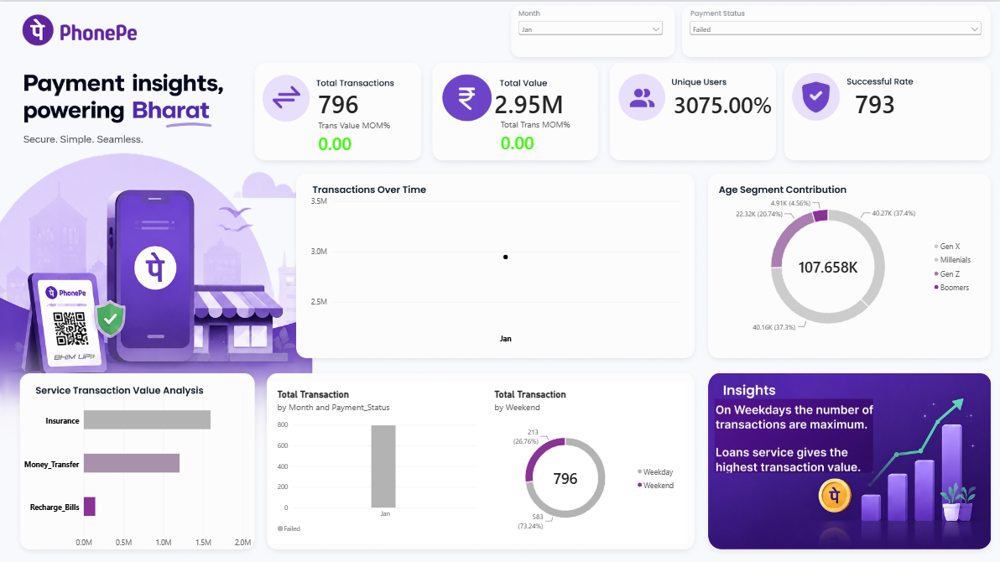

# PhonePe Payment Analysis Dashboard | Power BI

An interactive **PhonePe Payment Analytics Dashboard** built using Microsoft Power BI to explore digital payment transactions, customer segments, payment performance, and service-wise transaction trends.

## Dashboard Preview



## Project Overview

This project focuses on analyzing PhonePe transaction data and transforming it into meaningful business insights through interactive visualizations, KPI cards, and filters.

The dashboard helps understand transaction performance, user distribution, service contribution, and payment trends.

## Key Performance Indicators (KPIs)

- **Total Transactions:** Overall number of payment transactions.
- **Total Value:** Total monetary value of transactions.
- **Unique Users:** Number of unique users.
- **Successful Rate:** Payment success rate.

## Dashboard Features

### 1. Transaction Analysis
- Transactions over time.
- Monthly transaction analysis.
- Month-wise payment status comparison.

### 2. User Demographics
- Age segment contribution.
- Generational user distribution.

### 3. Service Analysis
- Service-wise transaction value comparison.
- Comparison of transaction values across different services.
- Service-level performance analysis.

### 4. Payment & Time Analysis
- Weekday vs Weekend transaction comparison.
- Payment status analysis.
- Month and payment status filtering.

### 5. Business Insights
- Weekdays show maximum transaction activity in the displayed analysis.
- Loans service contributes the highest transaction value in the displayed analysis.

## Interactive Filters

- **Month:** Filter dashboard data by month.
- **Payment Status:** Analyze transactions based on payment status.

## Tools & Technologies

- Microsoft Power BI
- Power Query
- DAX (Data Analysis Expressions)
- Data Modeling
- Data Visualization

## Data Model

The Power BI project includes the following tables:

- `All_Transactions`
- `All_Users`
- `Date_Table`
- `Measure`

## Project Structure

```text
PhonePe_Analysis/
│
├── Assets/
│   ├── Background.png
│   ├── calendar-icon.png
│   ├── Colors.png
│   └── phonelogo.png
│
├── PhonePe_Analysis.pbix
├── README.md
└── dashboard.png.png
```

## Project Objective

To develop an interactive business intelligence dashboard that converts digital payment data into understandable visual insights and supports data-driven analysis.

---

**Project:** PhonePe Payment Analysis  
**Category:** Data Analytics / Business Intelligence  
**Tool:** Microsoft Power BI

